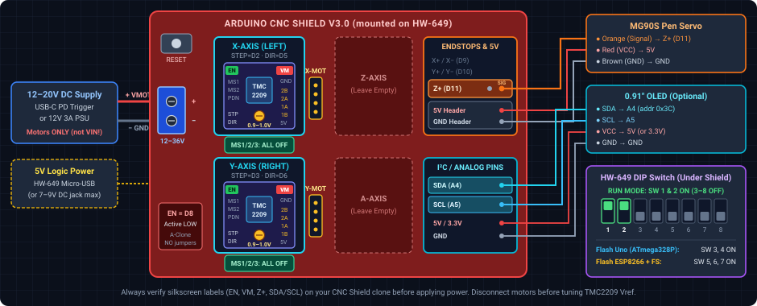

# Mural v2 on HW-649 (UNO+WiFi R3) + Arduino CNC Shield V3.0

This guide explains how to build, wire, flash, and run **Mural v2** using:

- **HW-649** (`UNO+WiFi R3 ATmega328P + ESP8266 32Mb/4MB CH340G`)
- **Arduino CNC Shield V3.0** with two **TMC2209** stepper driver modules (standalone STEP/DIR mode)
- Standard Mural v2 hardware (2× NEMA 17 pancake steppers, MG90S servo, optional 0.91" I2C OLED display)
- **No SD Card** — drawing commands stream live from your web browser over WiFi!

---

## How the Dual-Chip Architecture Works

The HW-649 puts both an **ATmega328P** (Arduino Uno) and an **ESP8266** (WiFi + 4 MB flash) on a single Uno-shaped PCB connected via an internal hardware serial bus (controlled by the onboard 8-way DIP switch):

1. **ESP8266 (`firmware/mural_esp8266/`)**:
   - Hosts WiFi / hotspot (`Mural`), mDNS (`http://mural.local`), and serves the React Web UI from LittleFS.
   - Runs the full 64-bit Mural v2 kinematic model (belt angles, torque equilibrium solver, belt stretch compensation, and 1 mm linear interpolation).
   - Buffers commands streamed live from the web browser over WiFi (`POST /stream`, 64-command ring buffer with sequence numbers, backpressure, automatic retries, pause/resume, and stop).
   - Sends compact, framed step-space & servo commands (`57600` baud) to the ATmega328P.

2. **ATmega328P (`firmware/mural_uno/`)**:
   - Plugs directly into the **CNC Shield V3.0**.
   - Runs real-time `AccelStepper` pulse generation with a 10-slot local FIFO motion/pen queue so WiFi bursts never stutter the motors.
   - Drives the **MG90S pen servo** smoothly without blocking stepper pulses.
   - Drives the optional **0.91" SSD1306 I2C OLED** on `A4/A5` using a zero-framebuffer driver (auto-detected; works fine with or without an OLED connected).

---

## 1. Hardware Wiring & Jumpers



> *Note: Exact physical placement of peripheral headers varies slightly across CNC Shield V3.0 clones. Always match the silkscreen labels (`EN`, `VM`, `Z+`, `SDA`/`SCL`) printed on your board before applying power.*

### CNC Shield V3.0 Pin Mapping

| Component | CNC Shield V3.0 Header | ATmega328P Pin | Notes |
|---|---|---|---|
| **Left Stepper Motor** | **X** motor slot | STEP=`D2`, DIR=`D5` | Left motor direction is inverted in software (`INVERT_LEFT_DIR = true`) |
| **Right Stepper Motor** | **Y** motor slot | STEP=`D3`, DIR=`D6` | `INVERT_RIGHT_DIR = false` |
| **Stepper Driver Enable** | Onboard shared EN | `D8` (Active LOW) | Held LOW on boot so carriage stays suspended |
| **MG90S Pen Servo** | **`Z+` (or `Z-`) Endstop** + `5V` + `GND` | Signal=`D11` | `Z+` silkscreen header connects to Arduino `D11` |
| **0.91" I2C OLED** *(optional)* | `SDA` + `SCL` + `5V` + `GND` | `SDA=A4`, `SCL=A5` | Address `0x3C`, 128×32 SSD1306. Auto-detected on boot |

> **Servo Power Tip:** If the MG90S servo causes the board to brown out or reset when moving, power the servo's red `5V` wire from an external 5V buck converter (sharing `GND` with the CNC Shield).

### Microstepping Jumpers for TMC2209 (CRITICAL!)

Mural v2 expects **1/8 microstepping** (`1600` steps/revolution for standard 1.8° NEMA 17 steppers).

In **TMC2209 standalone (STEP/DIR) mode**, the microstepping jumper table is **different from A4988**! Under **both** the **X** and **Y** TMC2209 driver sockets on the CNC Shield V3.0, **remove ALL THREE jumpers**:

| CNC Shield Jumper | TMC2209 State | Result |
|---|---|---|
| **M0 / MS1** | **Removed** (LOW) | **1/8 microstepping** with StealthChop2 (silent) + 256× MicroPlyer interpolation |
| **M1 / MS2** | **Removed** (LOW) | *(Do not install — `MS1+MS2 ON` gives 1/16 on TMC2209!)* |
| **M2 / MS3** | **Removed** | **NEVER install with TMC2209** (on TMC2209 modules this pin is `SPREAD`/`PDN_UART`/`CLK`, not MS3!) |

*(Reference — TMC2209 standalone table: `MS1=OFF, MS2=OFF` → **1/8**; `MS1=ON, MS2=ON` → 1/16; `MS1=ON, MS2=OFF` → 1/32; `MS1=OFF, MS2=ON` → 1/64. If you ever switch to 1/16 microstepping, change `MICROSTEPS` from `8` to `16` in `firmware/mural_esp8266/config.h`.)*

### Setting Up the TMC2209 Modules & Tuning the Trim Pot (`Vref`)

Follow these steps carefully **before** connecting your stepper motors to avoid damaging the drivers or overheating the motors:

#### Step 1: Install Heatsinks & Check Extra Pins
1. Stick the included aluminum heatsink onto the flat thermal pad on top of each TMC2209 module. Make sure the metal heatsink **does not touch any solder pins or tiny SMD components** around the edges.
2. Check the underside of your TMC2209 modules (especially BigTreeTech v1.2/v1.3): some boards have two extra downward pins (`DIAG` and `INDEX`). Confirm they sit cleanly over empty space on the CNC Shield and don't touch any header pins underneath (Mural v2 does not use `DIAG`/`INDEX`).

#### Step 2: Check Driver Orientation (Do NOT Match Pot Position!)
> **ORIENTATION WARNING:** On most TMC2209 modules (BTT, MKS, FYSETC), the adjustment trim pot is on the **opposite end** compared to an A4988!
> - **Always align the `EN` pin** on the TMC2209 with the **`EN` label** on the CNC Shield V3.0.
> - Double-check that **`VM` (`VMOT`)** and **`GND`** match the CNC Shield silkscreen before plugging the modules into the **X** and **Y** sockets.
> - Leave the **Z** and **A** driver sockets empty (and leave all A-axis clone jumpers removed).

#### Step 3: Tune the Onboard Trim Pot (`Vref`)
The BOM NEMA 17 pancake steppers are rated for **1.0 A peak** (the original Mural v2 FluidNC firmware sets `rms_current(707)` mA). In standalone mode, standard TMC2209 modules with **`R110` (0.11 Ω)** sense resistors follow:

$$V_{\text{ref}} \approx I_{\text{RMS}} \times \sqrt{2} \approx I_{\text{RMS}} \times 1.414 \qquad \left(I_{\text{RMS}} \approx V_{\text{ref}} \times 0.707\right)$$

| Target `Vref` (for `R110` / 0.11 Ω) | Motor Current ($I_{\text{RMS}}$) | Notes |
|---|---|---|
| `0.85 V` | ~600 mA RMS | Coolest operation; good conservative starting point |
| **`0.95 V – 1.00 V`** | **~670 – 707 mA RMS** | **Recommended** — matches original Mural v2 FluidNC current |
| > `1.00 V` | > 707 mA RMS | **Avoid** on 1.0 A pancake steppers (may overheat / soften PLA mounts) |

*(Check the two small sense resistors on your TMC2209 PCB — nearly all are marked **`R110`** (0.11 Ω). If yours are marked `R100` (0.10 Ω), target **`0.85 V – 0.92 V`** instead.)*

**Workbench tuning procedure (repeat for both X and Y drivers):**
1. **Unplug both stepper motors** from the CNC Shield. *(Never connect or disconnect stepper motors while power is applied — the inductive kickback can permanently destroy a TMC2209!)*
2. **Power BOTH the 5 V logic rail (HW-649 USB) AND the 12–20 V motor supply (`VMOT` blue screw terminal)** — unlike A4988, TMC2209's internal reference voltage (`5VOUT`) requires `VMOT` to be powered; with USB alone, `Vref` reads only ~0.3–0.4 V. Keep the stepper motors disconnected while probing!
3. **Do NOT put a jumper on `EN/GND`** — `Vref` does not require `EN` to be jumped, and `mural_uno.ino` drives `EN` (`D8`) `LOW` automatically.
4. Set a multimeter to **DC Volts** (`2 V` or `20 V` range):
   - Touch the **black probe (COM)** to any **`GND`** pin on the CNC Shield (or the negative `−` screw of the blue terminal).
   - Touch the **red probe (+)** to the **`VREF` test via/pad** next to the trim pot, or directly onto the metal body of the trim pot itself.
5. Use a **small ceramic/insulated screwdriver** (be extra careful not to slip and short nearby pins while `VMOT` is live) in **tiny 5–10° increments**:
   - TMC2209 trim pots are delicate single-turn (~270°) pots — **do not force past the end stop**.
   - Check which way raises voltage on your board (clockwise vs. counter-clockwise varies by manufacturer) and dial it to **`0.95 V – 1.00 V`**.
6. **Disconnect BOTH 12–20 V motor power and USB power completely**, wait a few seconds for capacitors to discharge, then plug your Left stepper into **X-MOT** and Right stepper into **Y-MOT**.
7. Once running, touch-check the pancake motors after 5–10 minutes of holding/drawing: they should feel comfortably warm (~40–50 °C), never painfully hot. If too hot, power down, disconnect motors, and lower `Vref` slightly (e.g. `0.85 V`).

### Power Supply Warning

> **IMPORTANT:** Do **NOT** connect a 20 V USB-C PD trigger directly to the HW-649 barrel jack or `VIN` pin — the HW-649's onboard voltage regulator is rated for **7–9 V max**!
>
> - Connect **12 V – 20 V** motor power **only** to the **CNC Shield V3.0 blue screw terminal** (`12–36V` / `PWR`).
> - Power the HW-649 logic either via its **Micro-USB port (5 V)** or a small 5 V / 7–9 V buck converter stepped down from your main supply.

---

## 2. HW-649 DIP Switch Reference

The HW-649 has an 8-position DIP switch that routes the CH340G USB-Serial chip between the ATmega328P and ESP8266. **Always press the board's Reset button after changing DIP switches.**

| Mode | SW1 | SW2 | SW3 | SW4 | SW5 | SW6 | SW7 | SW8 | Purpose |
|---|---|---|---|---|---|---|---|---|---|
| **1. Flash ATmega328P** | OFF | OFF | **ON** | **ON** | OFF | OFF | OFF | OFF | Upload `mural_uno` via USB |
| **2. Flash ESP8266** | OFF | OFF | OFF | OFF | **ON** | **ON** | **ON** | OFF | Upload `mural_esp8266` & LittleFS via USB |
| **3. Run Mural (Normal)** | **ON** | **ON** | OFF | OFF | OFF | OFF | OFF | OFF | Connect ATmega328P ↔ ESP8266 |

*(Remove the CNC Shield or make sure nothing blocks access to the DIP switches while flashing; you can also flip them gently with a toothpick/tweezers.)*

---

## 3. Building & Flashing

### Option A: VS Code Tasks with `wslc` Devcontainer (Recommended on Windows)

The project devcontainer (`.devcontainer/Containerfile` + `.devcontainer/devcontainer.json`) uses **WSL Containers (`wslc`)** instead of Docker Desktop and includes PlatformIO Core, Node.js 22 LTS, and all native `node-canvas` build libraries.

Because `wslc` does not pass host USB/COM ports into containers, **firmware + web UI builds run automatically inside the `wslc` devcontainer**, while **USB serial uploads flash the pre-built binaries directly from the Windows host** (`pio -t nobuild`).

**Prerequisites (Windows):**
- WSL with native container support (`wsl --update`; verify with `wslc --version`).
- PlatformIO installed on Windows (e.g. via the PlatformIO IDE VS Code extension) so host `pio.exe` can flash over COM ports.
- *(Optional, if reopening the workspace inside the container via Dev Containers)* Set `"dev.containers.dockerPath": "wslc"` in your VS Code **User** `settings.json` (`%APPDATA%\Code\User\settings.json`).

**Using VS Code Tasks (`Ctrl+Shift+B` or *Terminal → Run Task…*):**

| VS Code Task | What It Does |
|---|---|
| **`Firmware: Build All (HW-649 Uno + ESP8266 + LittleFS)`** *(Default Build Task — `Ctrl+Shift+B`)* | Auto-builds the `mural-devcontainer:latest` `wslc` image if missing, caches PlatformIO toolchains in the `mural-pio-core` volume, installs `worker`/`ui` npm deps if needed, and builds `hw649_uno`, `hw649_esp8266`, and `littlefs.bin` inside `wslc`. |
| **`Firmware: Build HW-649 Uno (ATmega328P)`** | Builds `hw649_uno` inside `wslc`. |
| **`Firmware: Build HW-649 ESP8266 (Firmware + LittleFS)`** | Builds Web UI assets, `hw649_esp8266` firmware, and `littlefs.bin` inside `wslc`. |
| **`Firmware: Upload HW-649 Uno (ATmega328P)`** | Builds `hw649_uno` in `wslc`, then flashes over USB from Windows. *(Set DIP **SW 3 & 4 ON**.)* |
| **`Firmware: Upload HW-649 ESP8266 (Firmware + LittleFS)`** | Builds `hw649_esp8266` + LittleFS in `wslc`, then flashes both firmware and Web UI over USB from Windows. *(Set DIP **SW 5, 6 & 7 ON** and press Reset.)* |
| **`Firmware: Upload HW-649 ESP8266 (Firmware)`** / **`(Web UI LittleFS)`** | Builds in `wslc` and flashes only the ESP8266 firmware or only the LittleFS Web UI image. |
| **`Devcontainer: Rebuild wslc Image`** | Rebuilds `mural-devcontainer:latest` from `.devcontainer/Containerfile`. |

**Step-by-step flashing flow:**
1. **Flash ATmega328P**:
   - Set DIP switches **3 & 4 ON** (all others OFF) and plug in USB.
   - Run task **`Firmware: Upload HW-649 Uno (ATmega328P)`** *(or CLI: `.\.devcontainer\wslc-pio.ps1 build hw649_uno; .\.devcontainer\wslc-pio.ps1 upload hw649_uno`)*.
2. **Flash ESP8266 firmware + Web UI (LittleFS)**:
   - Set DIP switches **5, 6, 7 ON** (all others OFF) and press **Reset**.
   - Run task **`Firmware: Upload HW-649 ESP8266 (Firmware + LittleFS)`** *(or CLI: `.\.devcontainer\wslc-pio.ps1 build hw649_esp8266; .\.devcontainer\wslc-pio.ps1 upload hw649_esp8266-all`)*.
   - *(Tip: To force a specific COM port from PowerShell, pass `-Port COM5` to `.\.devcontainer\wslc-pio.ps1 upload ...`.)*
3. **Switch to Run Mode**:
   - Set DIP switches **1 & 2 ON** (all others OFF) and press **Reset**.

*(If you run PlatformIO + Node.js natively on Linux/macOS or inside a container with USB passthrough, the same VS Code tasks run `pio` directly, or you can run `npm i --prefix worker && npm i --prefix ui`, `pio run -e hw649_uno -t upload`, `pio run -e hw649_esp8266 -t upload`, and `pio run -e hw649_esp8266 -t uploadfs`.)*

---

### Option B: Arduino IDE 2.x

1. **Install Board Packages & Libraries in Arduino IDE**:
   - Add ESP8266 Board URL in *Preferences → Additional Boards Manager URLs*:
     `https://arduino.esp8266.com/stable/package_esp8266com_index.json`
   - In *Boards Manager*, install **esp8266** (ESP8266 Community) and **Arduino AVR Boards**.
   - In *Library Manager*, install:
     - **AccelStepper** (by Mike McCauley)
     - **WiFiManager** (by tzapu, v2.0.17+)

2. **Flash ATmega328P (`firmware/mural_uno/mural_uno.ino`)**:
   - Set DIP switches **3 & 4 ON** (all others OFF).
   - Open `firmware/mural_uno/mural_uno.ino`.
   - Select Board: **Arduino Uno**, choose the CH340 COM port, click **Upload**.

3. **Flash ESP8266 (`firmware/mural_esp8266/mural_esp8266.ino`)**:
   - Set DIP switches **5, 6, 7 ON** (all others OFF), press **Reset**.
   - Open `firmware/mural_esp8266/mural_esp8266.ino`.
   - Select Board: **Generic ESP8266 Module** with:
     - Flash Size: **`4MB (FS:2MB OTA:~1019KB)`**
     - Upload Speed: **`460800`** (or `115200` if unstable)
   - Click **Upload**.

4. **Upload the Web UI to ESP8266 LittleFS** *(or use Option C below to serve the UI from your PC)*:
   - Build the compressed web assets:
     ```bash
     cd worker && npm install && cd ../ui && npm install && cd ..
     python build.py
     ```
     This populates `firmware/mural_esp8266/data/www/*.gz`.
   - With DIP switches **5, 6, 7 ON**, run the Arduino IDE LittleFS Uploader (`Ctrl+Shift+P` → *Upload LittleFS to Pico/ESP8266/ESP32*).

5. **Switch to Run Mode**:
   - Set DIP switches **1 & 2 ON** (all others OFF) and press **Reset**.

---

### Option C: Run the Web UI from Your Laptop/PC Browser (Skip LittleFS Upload!)

If you prefer not to upload the web UI to ESP8266 LittleFS, the ESP8266 API includes full CORS headers:

```bash
cd worker && npm install && npm run build
cd ../ui && npm install && npm run dev
```

Then open the local URL in your browser with `?host=http://mural.local` (or `?host=http://<HW649_IP>`), for example:

```
http://localhost:5173/?host=http://mural.local
```

---

## 4. First-Time WiFi Setup & Live Browser Streaming

1. Power on your HW-649 with DIP switches **1 & 2 ON**.
2. On first boot, it creates a WiFi hotspot named **`Mural`**. Connect to it from your phone or laptop and configure your home WiFi (or select *Use without WiFi* to stay in hotspot mode at `http://192.168.4.1`).
3. Once connected, open **`http://mural.local`** (or the IP address shown on the OLED display).
4. Walk through the standard Mural v2 workflow:
   - **Set Top Distance** (use the `⚙` Tools menu first to check motor directions and park the servo!)
   - **Choose SVG or Photo → Preview → Accept** (commands stay in your browser — no SD upload wait!)
   - **Retract Belts → Extend to Home → Pen Calibration**
   - **Begin Live Streaming**: keep the browser tab open while Mural draws! You get a live progress bar, buffer meter, **Pause / Resume**, and **Stop** controls, plus automatic Screen Wake Lock and WiFi retry recovery.

---

## 5. Troubleshooting

- **Warning banner `"ATmega328P not responding"`**:
  - Verify DIP switches **1 & 2 are ON** and **3–8 are OFF**, then press the Reset button.
  - Confirm both `mural_uno` and `mural_esp8266` were flashed at the same `LINK_BAUD_RATE` (`57600`).
- **A stepper motor spins the wrong direction**:
  - Either flip the 4-pin stepper motor plug 180° on the CNC Shield (with power OFF!), or toggle `INVERT_LEFT_DIR` / `INVERT_RIGHT_DIR` in `firmware/mural_uno/config.h` and re-flash the Uno.
- **Motors don't move or buzz/skip**:
  - Check that 12–20 V power is connected to the CNC Shield blue terminal.
  - Check **TMC2209 orientation** (`EN` aligns with `EN` on the CNC Shield — do not go by potentiometer position!) and `Vref` (`~0.90–1.00 V` for `R110` sense resistors).
  - Verify **ALL 3 microstepping jumpers (`MS1`, `MS2`, `MS3`) are removed** under both X and Y TMC2209 drivers (an installed `MS3` jumper can prevent stepping on some TMC2209 boards).
